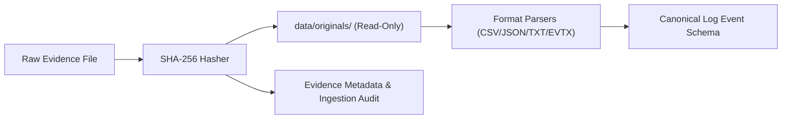

# ForensicShield AI: Technical Methodology & Evidence Custody

## 1. Evidence Ingestion & Cryptographic Hashing (Stage 1 & 2)

Forensic integrity requires that original evidence files remain bit-for-bit immutable throughout the entire investigation lifecycle.



1. **Intake Gate:** When an investigator uploads an authorized log file (`.csv`, `.txt`, `.log`, `.json`, `.jsonl`, `.evtx`), the raw bytes stream is hashed using standard `hashlib.sha256()` **before** parsing.
2. **Restricted Storage:** The raw file is stored under `data/originals/<case_id>/<evidence_id>_<safe_filename>` and marked read-only on the filesystem.
3. **Immutability Verification:** Any subsequent operation can verify evidence integrity using `EvidenceIntegrityManager.verify_stored_file()`.

---

## 2. Canonical Forensic Schema (Stage 3)

Regardless of the incoming log format (Linux Syslog, Windows Security CSV, EVTX dump, or JSON), all logs are normalized into a unified, canonical data structure:

```
case_id, evidence_id, event_id
source_path, source_sha256, original_row
timestamp_original, timestamp_utc
host, provider, event_code, user
raw_message, normalized_text
ground_truth_label, label_source
predicted_label, model_version, score
rule_flags, shap_features
```

- **Fidelity Principle:** Unparseable or missing timestamps remain `null`—never fabricated or guessed.
- **Message Integrity:** The unmodified original text is strictly preserved in `raw_message`, while `normalized_text` holds sanitized representations for feature extraction.

---

## 3. NLP Feature Extraction & ML Classification (Stage 4 & 5)

1. **Sublinear TF-IDF:** Uses n-gram range (1, 2) to capture critical command associations (`delete shadows`, `clear log`, `history -c`).
2. **Leakage Safeguard:** The vectorizer is fitted strictly on the training partition of the dataset. Test or evaluation records are vectorized using the pre-fitted vocabulary only.
3. **Ensemble Classifier:** `RandomForestClassifier` with balanced sub-sampling to address inherent class imbalance between high-volume normal system activity and rare anti-forensic evasion commands.

---

## 4. Cryptographic Hash Chain Audit Ledger (Section 7)

Every critical action creates a forward-linked block:
$$\text{EntryHash}_n = \text{SHA-256}\left(\text{EntryHash}_{n-1} \parallel \text{CaseID} \parallel \text{Actor} \parallel \text{Action} \parallel \text{Timestamp} \parallel \text{InputHash} \parallel \text{OutputHash}\right)$$

- **Tamper Detection:** `AuditTrail.verify_chain(case_id)` iterates across blocks, recalculating hashes and backward linkage. Any modification, deletion, or insertion breaks the chain and flags the exact corrupted block index.
- **Legal Scope:** Cryptographic hash chains document application-level procedural integrity; they do not replace formal statutory judicial chain-of-custody certificates.

---

## 5. Structured Court-Admissible Reporting (Stage 8)

Generated via ReportLab with:
- Formal Case Identification and Lead Examiner metadata.
- Evidence Integrity table with original SHA-256 digests.
- Detection Methodology and pipeline SHA-256 provenance.
- Chronological findings table with confidence scores.
- Explainable AI highlights with SHAP token attributions.
- Silent log continuity gaps and contextual timeline events.
- Audit trail verification status and block count.
- Mandatory legal admissibility notice and double examiner sign-off blocks.
